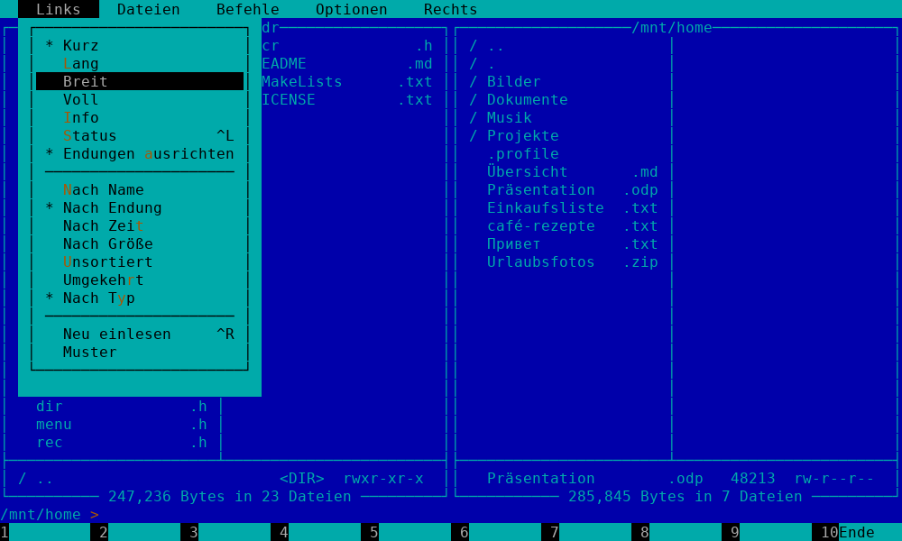

# GonWare Commander

The GonWare Commander is the file manager of
[GonWare](https://gitea.disconnected-by-peer.at/GonSoft/GonWare)
(`CMDR.EXE`). It grew from the Demos Commander (`deco`) by Serge Vakulenko,
a two-panel text-mode file manager for Unix, and still builds for Unix
systems as `deco`.

## What it is

Two panels show the file system. The arrow keys move between files,
Insert selects files, and the function keys copy, rename or move, make
directories, delete, view and edit. F9 opens the menu bar; the user menu
(F2) and the extensions file run commands of your own. A command line
under the panels runs the shell.

What the GonWare Commander adds to deco:

- **The screen size:** the panels follow the width and height of the
  terminal or window, as do the menus, dialogs, viewer and editor.
- **Colours** after the VC scheme, a role per part of the screen (panels,
  menu bar, menus, dialogs, viewer, lists, F-key bar).
- **Unicode:** a screen cell holds a code point, so file names, texts and
  files in UTF-8 are shown and edited as characters. One code point is one
  cell for now; double-width (CJK, emoji) and combining characters are not
  drawn as such yet.
- **Languages** through gettext (text domain `cmdr`): English, German,
  French, Spanish and Italian. The language comes from `LANGUAGE`,
  `LC_ALL`, `LC_MESSAGES` or `LANG`, or from Options/Language, which
  switches at once and is kept by Options/Save setup.
- **Two screen backends:** termcap, as in deco, or newt/S-Lang
  (`DECO_NEWT`), which GonWare uses.

## Build and install

    git clone https://gitea.disconnected-by-peer.at/GonSoft/deco
    cd deco
    cmake -B build
    make -C build
    make -C build install

`cmake -B build -DDECO_NEWT=ON` builds the newt/S-Lang screen (it needs
newt and S-Lang). The catalogues `po/*.po` are built with `msgfmt` and
installed with the program. GonWare builds `CMDR.EXE` from this
repository as its submodule `third_party/deco`, with the translations
built in.

## Translations

`po/cmdr.pot` holds the texts; `po/update.sh` extracts them from the
sources again and merges them into every `po/<language>.po`. A new
language is a new `po/<language>.po` (from `po/cmdr.pot`, `msginit` or a
copy) and an entry in `trlangs` in `intl.c` for Options/Language.

## License

MIT, see [LICENSE.txt](LICENSE.txt): Copyright (C) 1989-2000 Serge
Vakulenko for the Demos Commander, Copyright (C) 2026 Mario Fetka for the
GonWare Commander changes.
